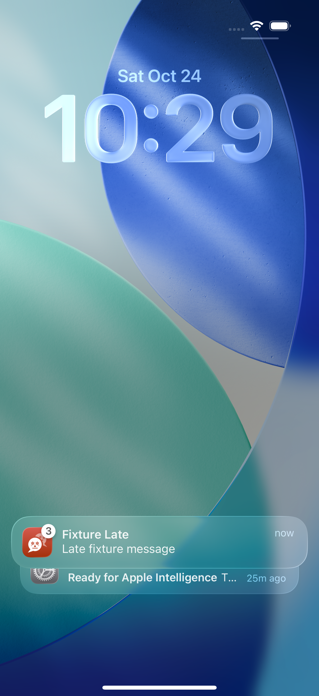
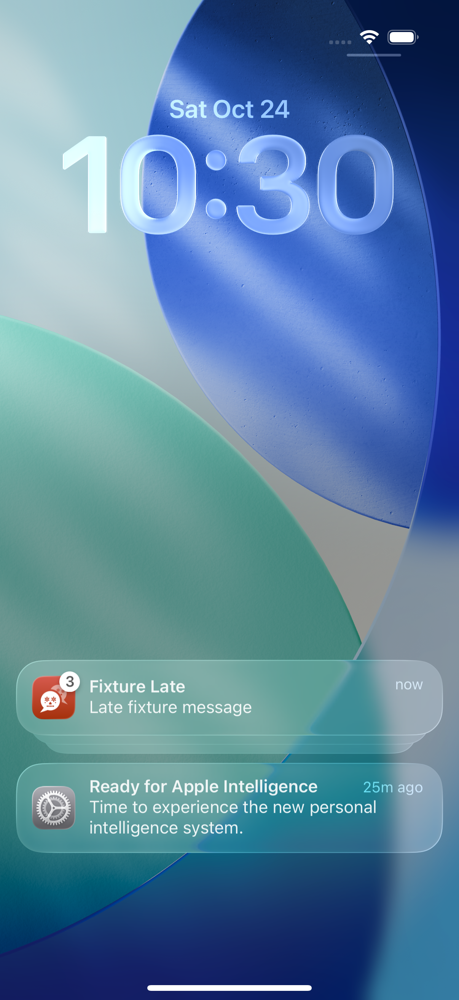
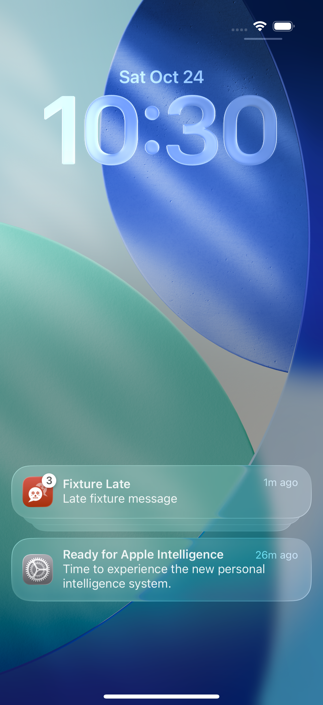

# Hosted compact-list discovery failure

PR: https://github.com/azuretek/cuate/pull/508 ; issue: https://github.com/azuretek/cuate/issues/507 .

Historical source: `2449d307d22fd8a13743216d840c00a18dc0048a`. Failed hosted iOS run: https://github.com/azuretek/cuate/actions/runs/40136665450 ; artifact `ios-boot-proof`, ID `12577779706`.

## Actual retained failure

`LateNoticeTests.testInjectedNoticeRevealsALateMessage` failed after 95.312 seconds at line 82. The requested injected body was not exposed. It was not accepted as delivered or routed.

The retained video and screenshots show TWO levels of presentation: Notification Center initially compacts its list, then the app itself groups three notices. The recorded native content-button press at test time 61.52 seconds expands the compact LIST. The system Settings notice below becomes fully exposed, while the Cuate app group moves upward and remains collapsed with a count of three. This is not evidence that the tap was dropped. The original one-shot discovery state nevertheless considered expansion consumed and never pressed the now-exposed app group.

The synthesized-event attachment records the actual press at `(201,681)` on a `402x874` screen. The retained final accessibility tree records the still-grouped content button at `{{14.0,576.8},{374.0,66.0}}`. These are different phases, not proof that the initial press missed. The before/after video confirms the movement follows that press.

Before the content-button press:

After that press: list exposed, app group still collapsed:

At the terminal failure, the app group remains collapsed:

All captures were inspected: synthetic fixture and simulator system notices only. Displayed screenshot clock belongs to the hosted runner.

## Bounded repair and regression

Source `86a33da5ada69b564e6f59d23542736fd6bea264` distinguishes compact-list and app-group expansion. A second discovery press is allowed only after an observed different settled on-screen button frame; an ineffective same-frame press is never retried, and no third group press is allowed. Both discovery phases retain native existence, hittability and consecutive stable-frame checks.

The SAME 30-second Notification Center budget remains. The distinct injected body, stable target, actual target tap, foreground return and late-message routing assertions remain mandatory and unchanged. No application behavior, workflow, timeout or tolerance was changed. Post-press accessibility trees are now retained for each phase.

The exact test-support source and XCTest file were compiled with the installed Xcode toolchain and native macOS XCTest, without booting any simulator. Seven tests passed: the four existing regressions plus moving-frame, reset and two-stage-transition regressions. Mutation restoring the one-shot behavior fails the transition test: expected `expandGroup`, actual `waitForTarget`. The original native test binary then passed all seven again. Native iOS acceptance remains a separate hosted gate.

## Historical individual outcomes, not new-head acceptance

At `2449d307`:
- Four NoticeGroupReadiness XCTest cases passed individually.
- Actual PushSealing decoder XCTest cases passed: server-sealed notice/retained target (0.171 seconds), wrong-key/tamper/absent-key refusal (0.004 seconds).
- Background local-notice actual tap/routing passed (46.122 seconds).
- Foreground presentation passed (9.533 seconds).
- Isolated clean-state denial passed (51.142 seconds). Its ordinary-suite opt-in skip is not the denial pass.
- Ordinary suite: 30 unit tests, zero failures; 29 UI tests, two opt-in skips, zero failures. MessageCache also passed this run, which does not explain or repair its older independent timing failure.
- Injected remote-content presentation/tap/routing FAILED and remains unproven.

At `86a33da5`, hosted native acceptance and the complete platform matrix are pending. This document does not claim successful injected delivery, a merge, release or installation. A group count never proves its hidden notice bodies. The actual OS service-extension invocation, shared Keychain entitlements, APNs/Firebase/network delivery remain unproven. No real-phone push or production change was performed.
