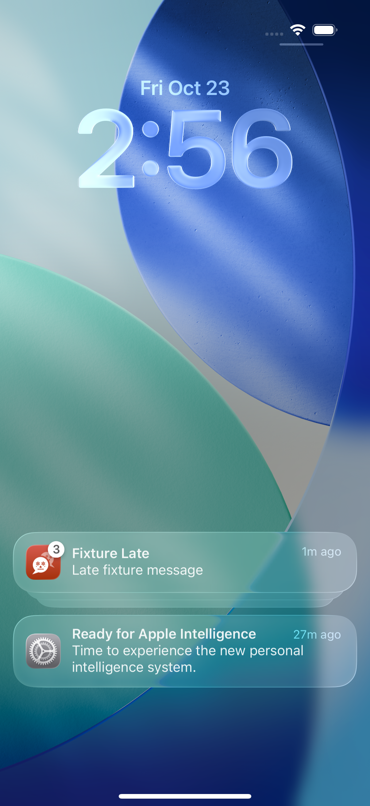

# Group-discovery acceptance at aa70ac9e

Exact head: aa70ac9eaf4be5e017a7c3a3c9bba5626894a455
Run: https://github.com/azuretek/cuate/actions/runs/39889564821
Retained artifact: 12475656963, ios-boot-proof.

Actual results: all three NoticeGroupReadinessTests and both PushSealingTests passed. Isolated denied-permission passed (56.526s). Ordinary native UI had 29 tests, two skips, one failure: MessageCache warm-first-draw 737ms was not less than cold 636ms. The independent cache timing assertion is unchanged.

Injected probe failed (103.022s). The XCTest trace records Tap ListCell ScrollView at 67.16s. The before, post-tap and final screenshots and final accessibility tree show the same collapsed three-notice group. Calling the tap did not establish expansion. The tree contains a nested Button with identifier ShortLook.Platter.Content.Seamless. The injected body is still not exposed, so neither delivery nor tap routing passed.

Repair 2449d307d22fd8a13743216d840c00a18dc0048a targets that nested content button and consumes its single discovery attempt only when the button exists and is hittable. It adds a fourth readiness regression for a container without its actionable button. It does not change workflow, assertion, target, timeout, production code or the cache timing gate. Fresh exact-head native validation is required: selecting a better hit target alone is not a passing acceptance result.

Decoder source tests and synthetic simctl injection do not establish actual OS extension invocation, shared Keychain entitlements, APNs/Firebase delivery, or a production/real-device repair.
