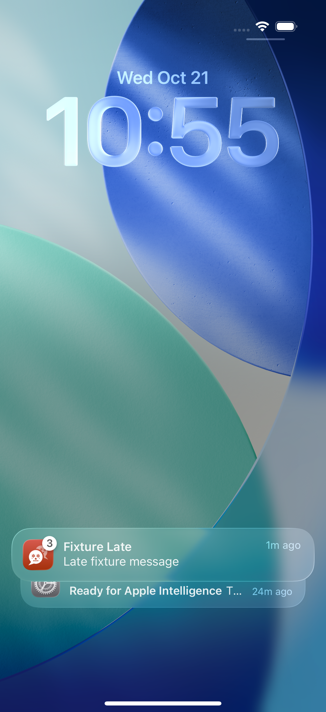

# Hosted acceptance at cb71d385

PR: https://github.com/azuretek/cuate/pull/508
Head: cb71d3850e8d5ea618eaf1aa15a6f119cc744ad3
Terminal failed iOS run: https://github.com/azuretek/cuate/actions/runs/39686548806
Artifact: ios-boot-proof, id12388646675.

- Ordinary UI: 29 tests, zero failures, two opt-in skips.
- Both actual PushSealingTests passed: valid server ciphertext/routing 0.023s; absent/wrong-key/tampering 0.010s.
- Isolated denied-permission test passed, 59.359s.
- Isolated injected-notice test failed, 93.432s: target absent from exposed banner/Notification Center tree.

simctl sent the distinct post-decryption payload to the same app bundle and simulator selected by xcodebuild, before the focused test launched the app. Ordinary tests had already exercised authorization. The focused test then raises a newer local fixture notice. The retained native tree exposes a collapsed ListCell labeled Grouped, 1 minute ago, Fixture Late, Late fixture message. The screenshot shows three notices in that stack. The probe never expands it, so searching the injected body cannot inspect hidden members. This establishes a discovery gap, NOT successful injected delivery or an app delivery defect.

Repair aa70ac9 expands that observed group once inside the SAME thirty-second center budget. The distinct injected body, stable hittable frame, actual press, foreground and correct late-message reveal remain required. A local notice never counts as the target. Readiness regressions cover the retained label, absent/unrelated groups and an exposed target. No timeout or assertion is weakened.

The repair is retained on the validation host but NOT public or natively accepted. Publication was blocked by a source connection close followed by a bounded SSH timeout. No fresh CI result is claimed.

Decoder source proof is not OS service-extension invocation, shared Keychain entitlements or APNs/Firebase delivery. Denial and simctl do not prove production registration, connectivity, Focus or a real-device repair. No production or real-phone operation was performed.
